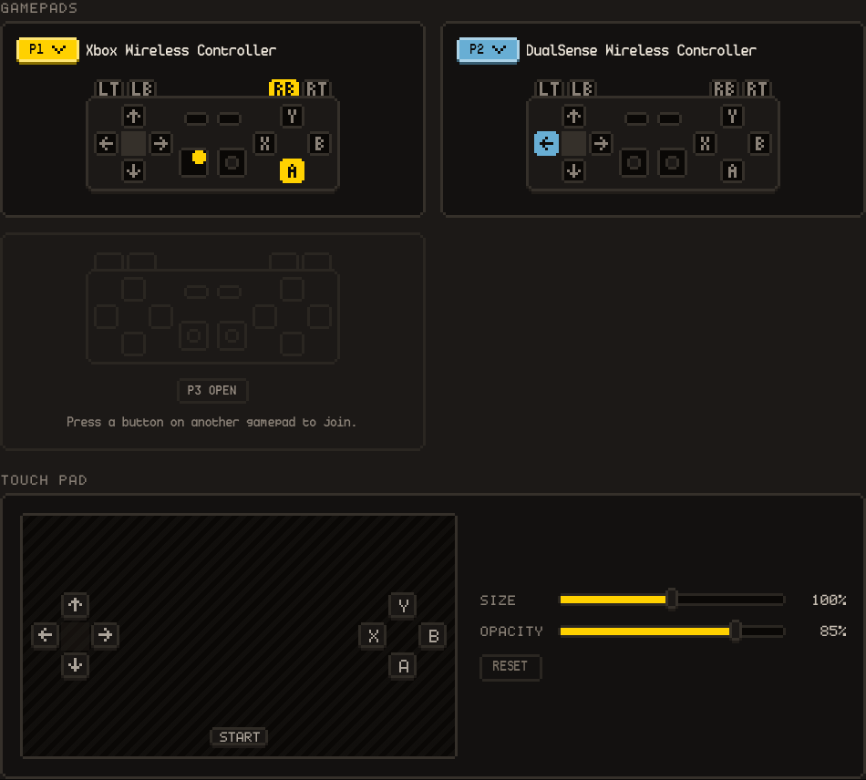

# input · Keys, buttons and the mouse

Two ways to read the player. **Actions** are the names a game gives to what a player does, `jump` or `left`, each with the keyboard keys and the gamepad controls that press it; the author sets them in the [GAME tab](/learn/editors/game#inputs) and every player gets them as set. Raw keys are read by name. Actions are the portable choice: a game that reads `"w"` does not work on an AZERTY keyboard, nor on a gamepad, nor on a phone.

## Actions

`held` is true while the action is held, `pressed` on the step it is pressed, `released` on the step it is released. The name is the one the action has in the GAME tab, and **a name the game does not have answers `false`**, without a warning.

A new game starts with nine actions, the Classic preset. The tutorials and the examples of this reference read these:

| Action | Player 1 keyboard | Player 2 keyboard | Gamepad |
| --- | --- | --- | --- |
| `left` `right` `up` `down` | Arrow keys, <kbd>W</kbd><kbd>A</kbd><kbd>S</kbd><kbd>D</kbd> and <kbd>Z</kbd><kbd>Q</kbd><kbd>S</kbd><kbd>D</kbd> | <kbd>I</kbd> <kbd>J</kbd> <kbd>K</kbd> <kbd>L</kbd> | D-pad or left stick |
| `a` | <kbd>X</kbd>, <kbd>Space</kbd> | <kbd>N</kbd> | A |
| `b` | <kbd>C</kbd>, <kbd>Shift</kbd> | <kbd>M</kbd> | B |
| `x` | <kbd>V</kbd> | <kbd>,</kbd>, and <kbd>;</kbd> on AZERTY | X |
| `y` | <kbd>B</kbd> | <kbd>.</kbd>, and <kbd>:</kbd> on AZERTY | Y |
| `pause` | <kbd>Esc</kbd>, <kbd>Enter</kbd> | <kbd>P</kbd> | Start |

### What presses an action

An action takes as many inputs as its author plugs into it, of two kinds. A **keyboard key** belongs to player 1 or to player 2, and a letter is one key whatever its case. A **gamepad control** is the same on every pad: the four directions of the D-pad, the four of the left stick, A, B, X and Y, the shoulders LB and RB, Start and Select.

The keyboard and the first gamepad are player 1 together; a second gamepad is player 2, and so on up to four. **The keys given to player 2 play as player 2**, whether or not a gamepad is plugged in.

A game holds 32 actions at most. A name is made of lower-case letters, digits and underscores, starts with a letter, runs to 24 characters and is used once in the game.

### On a touch screen

A phone or a tablet has neither keys nor a gamepad, so the console draws a gamepad on the screen: a cross, the buttons A, B, X and Y, and Start. It presses those controls for player 1, and each arm of the cross presses the left stick's direction as well.

The pad **draws only the controls an action is plugged into**, so a game that reads two directions and one button shows two arrows and one button. LB, RB and Select have no place on it: an action plugged into nothing else cannot be played by touch.

Its size and opacity belong to the player, not to the game. They are in Settings › Controls, beside the gamepad the device has connected:



A jump reads the press, not the hold, or the player flies while the key is down:

```lua
local player = { x = 40, y = 40, vy = 0, on_ground = true }

function _update()
  if input.pressed("a") and player.on_ground then
    player.vy = -6
    player.on_ground = false
  end
end
```

{{api:input.held}}

{{api:input.pressed}}

{{api:input.released}}

{{api:input.players}}

## Raw keys

Key names are the browser's `event.key` values, and they are **case-sensitive and layout-dependent**: with <kbd>Shift</kbd> held the A key reports `"A"`, not `"a"`, and the key next to <kbd>Tab</kbd> reports `"q"` on a French keyboard. An action's key is spared the first of the two: it is matched whatever its case.

> [!WARNING]
> **`key_pressed` means held**, whatever its name says: it is `true` for every step the key is down, the way `held` is for an action. The step the key goes down is `key_down`. The mouse pair is the same: `mouse_pressed` while the button is held, `mouse_down` on the click.

{{api:input.key_pressed}}

{{api:input.key_down}}

| Key         | String         |
| ----------- | -------------- |
| Left arrow  | `"ArrowLeft"`  |
| Right arrow | `"ArrowRight"` |
| Up arrow    | `"ArrowUp"`    |
| Down arrow  | `"ArrowDown"`  |
| Space bar   | `" "`          |
| Shift       | `"Shift"`      |
| Enter       | `"Enter"`      |
| A key       | `"a"`          |

## The mouse

Positions are in screen pixels, `0` to `319` across and `0` to `179` down, and the camera does not move them. Buttons: **`0` is the left button, `1` the right, `2` the middle.**

{{api:input.get_mouse_pos}}

{{api:input.mouse_pressed}}

{{api:input.mouse_down}}
