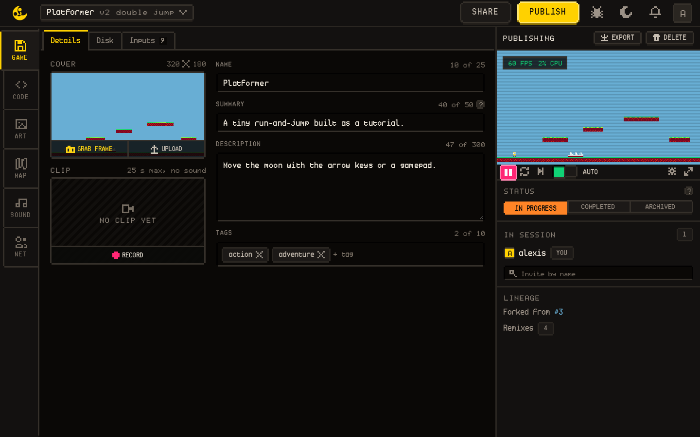
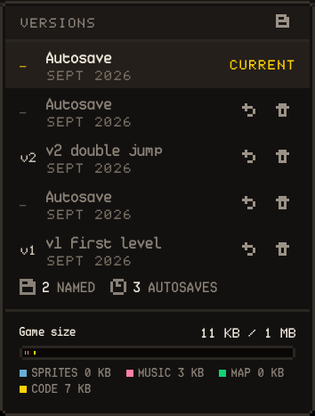
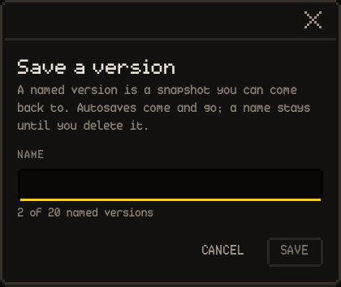
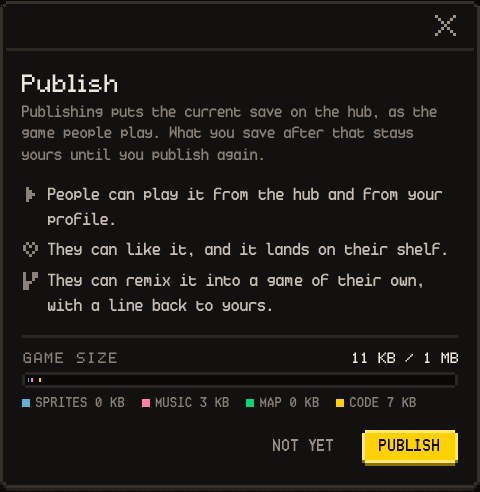
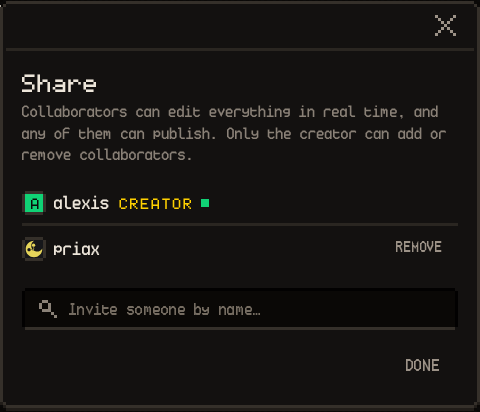

# GAME

The GAME tab is what the game is, what it looks like on a shelf and what plays it. Its workspace has three tabs, **Details, Disk and Inputs**, and the Publishing sidebar beside them holds the running game. The header above every tab belongs here too, with the versions, SHARE and PUBLISH.

## Details

The cover and the clip are two blocks of one shape, and both are taken from **the game running in the sidebar**. The words the game is listed under stand beside them.

### Cover

The cover is the game's picture everywhere it is listed, at **320 × 180**. Grab frame takes the frame that is on screen in the sidebar right now, so the game has to have run; Upload takes an image file, and you can also drop one on the cover.

### Clip

Record captures the running game as it is drawn: 320 × 180, no sound, **25 seconds at most**. Stop ends it early, and what was captured so far is the clip. While it records, the sidebar's screen is framed in red with the count, and the block shows the same picture with the time left.

The clip then plays in a loop in the block, with its length. Record again replaces it and Delete removes it, after asking. On the hub it plays over the cover of a disk that is reached.

> [!IMPORTANT]
> Only a running game can be recorded. Pausing it, or an error that halts it, **ends the recording there**; a game that is idle, paused or halted says so under the block instead of recording.

### Name, Summary, Description, Tags

The name is 25 characters at most, the summary 50, the description 300 and there are up to 10 tags, typed one at a time with <kbd>Enter</kbd>. The summary is the line under the game on the hub and what search shows for it: **say what it is, not how it was made**. The description is the long version, and Markdown is fine.

> [!IMPORTANT]
> A game needs a name and one line of summary before it can be published.

## Disk

A game stands on the hub as a disk, with its cover as the label. The Disk tab shows that disk at full size with the game's name under it, and everything that changes it beside it. **Nothing is applied**: a pick is the disk's style from then on, in every list.

### Game palette

The strip offers the sixteen colours of **the game's own palette**, the one the ART tab edits, and the one picked is the plastic the disk is moulded in.

The disk keeps the colour, not the slot. Repaint that slot in ART and the disk still wears what was picked, shown at the end of the strip as `Not in the palette any more`.

### Finish

Eight finishes, each on a tile that shows **this game's disk wearing it**: Solid, Stripes, Checker, Dots, Gradient, Gold, Silver and Holo. A pattern is printed in a shade of the body colour.

Gold, Silver and Holo are metals with a colour of their own. The palette dims while the disk wears one, and the colour picked is kept for the day it goes back to plastic.

### Gradient

Gradient opens two more rows. **Runs to** picks the colour the body fades into, from the same palette. Direction picks the way it runs: across, down, either diagonal, or out from the centre.

### Back to automatic

A game whose author picked nothing wears a plain disk in a colour drawn from the game itself, the same every time. Back to automatic **returns to that disk**.

## Inputs

A game defines **its own actions**: what a player does, each under the name the code reads it by with [[input.held]], [[input.pressed]] and [[input.released]]. An action also has a label and a short description, which are for the players, and the inputs plugged into it: keyboard keys of player 1 or player 2, and gamepad controls. What an input can be, and how a touch screen plays them, is in [input](/learn/api/input#actions).

### The actions

One table, a row per action: its label, its name in the code under it, and how many inputs it has. The chip beside Actions counts them against the **32** a game may hold, and the Inputs tab carries the same count.

A row opens onto its inputs, one per line: the key or the control, the device, and for a key the player whose keyboard it is. An action is not a key: in a new game `a` is <kbd>X</kbd> or <kbd>Space</kbd>, and the key <kbd>A</kbd> is `left`.

### Plug an input

Open an action, press Plug an input, then **press the key or the gamepad button**. <kbd>Esc</kbd> backs out, which is why it is the one key that cannot be plugged this way. The cross at the end of a line unplugs it.

A key lands on player 1. The `P1` button on its line hands it to player 2, and back.

When another action already holds the input, the tab asks before plugging it: **Move it here** takes it from the other action, Keep on both leaves it on the two, Cancel plugs nothing.

### Add, edit and remove

Add action and the pencil on a row open the same dialog, with three fields:

- **Label**, what players read, 25 characters at most.
- **Name in code**, what the code reads the action by: 24 characters at most, a lowercase letter then lowercase letters, digits and `_`, and no other action's name. The dialog says which of these a name breaks.
- **Description**, a line for the How to play panel, 60 characters at most.

Remove is in the dialog and on the row, as the trash. Both ask first.

> [!WARNING]
> Code that reads an action the game no longer has **keeps running and answers `false`**. Renaming an action does not rewrite the code: bring the calls to the new name yourself.

### Order

Drag a row to move its action, or hold <kbd>Alt</kbd> and press <kbd>↑</kbd> or <kbd>↓</kbd> on it. The order is **the one players see** in the How to play panel.

### Presets

Presets lists four sets of actions to start from. Picking one **replaces every action of the game**, after asking:

- **Classic**, what a new game has: `left`, `right`, `up`, `down`, `a`, `b`, `x`, `y` and `pause`, for two players.
- **Platformer**: `move_left`, `move_right`, `jump`, `dash`, `crouch`, `interact` and `pause`.
- **Top-down**: `move_left`, `move_right`, `move_up`, `move_down`, `primary`, `secondary` and `pause`.
- **Two players**: `left`, `right`, `up`, `down`, `action` and `pause`, each with keys of its own for either player.

After a preset, bring the calls to the new names: `input.held("a")` becomes `input.held("jump")`.

### Touch pad

Touch pad shows the on-screen pad **as a phone will draw it**. Nothing is set here: the pad is a gamepad, and it draws only the controls some action is plugged into, out of the nine it has a place for.

A control it has no place for is named beside the count, as in `RB is not on the pad`: an action reached only through it cannot be played on a phone.

### Shared, saved, the same for everyone

The actions are part of the game document. Two people plugging inputs into one action **both keep theirs**, and the actions are saved and published with the game.

Every player gets the inputs set here: nobody rebinds a game. The How to play panel on the game's page lists them, each with its label, its description and what presses it.

## Publishing

The sidebar on the right. Its head carries Export and Delete; under it stand **the running game**, then the game's status, who is here, and where it comes from.

### The running game

The screen is the editor's one running game, the same one the [console column](/learn/editors/code#the-console-column) of CODE shows, with the same transport under it. Coming here from another tab **does not restart it**, and it is this screen that Grab frame and Record take from.

While the screen floats in the viewer, the sidebar says so and offers Bring it back.

### Status

In progress, Completed or Archived. It is **a note for you and your collaborators, and nothing more**: publishing, not this, is what puts the game on the hub.

### Monetization

None, Ads or Paid, with a Price field for Paid. Paid games are not charged yet; this only marks the intent, so the hub can show it. The section appears only where the deployment sells games at all.

### In session

Everyone connected to the game right now, counted in the chip, with `You` on your own row. The host of the work session, whoever opened the game first, or the person who took over when they left, has a **Kick** button on every other row. Under the list, `Invite by name` searches for a person and adds them as a collaborator, the same thing the SHARE dialog does.

### Lineage

Where the game comes from: Forked from, with the parent and its creator, and Remixes, **how many games were made from this one**.

### Export and Delete

Export downloads the whole game as one file, `<name>.ncto`, the same bytes a saved version holds. There is no import in the editor: the file is a backup you keep, or something to inspect.

Delete is the creator's only. It asks, **Delete this game?**, then the game and everything in it goes, and it cannot be undone.

## Versions

The chip at the left of the header names the game and its **newest named version**, or `draft` while there is none. From 90 % of the size ceiling the game's size appears beside it, and turns red once it is over.

The chip opens the versions popover: one list, **newest first**, where named versions (`v1`, `v2`, numbered from the oldest) and autosaves are mixed. The top row is the game as it is, marked Current until someone edits again. Every other row can be restored, with the arrow, or deleted, with the trash. A restore enters the shared document like any edit, so everyone in the session gets it at once. Under the list, `N named · M autosaves`; under that, the Game size gauge (Sprites, Music, Map, Code) against the 1 MB ceiling.

### Save a version

The save icon at the head of the popover opens **Save a version**. Autosaves come and go; a name stays until you delete it.

The name is 32 characters at most. The field says `N of M named versions`, the server's own cap. **Reusing a name overwrites that version** with the game as it is now, and does not count against the cap; at the cap, the way to save is to reuse a name or to delete one first.

## Publish

PUBLISH opens the Publish dialog. Publishing puts the current save on the hub, as the game people play; what you save after that stays yours until you publish again. The dialog lists what a release allows: people can play it from the hub and your profile, like it, and **remix it into a game of their own**, with a line back to yours.

Under that, the same Game size gauge. Over 1 MB the notice says by how much and the button is disabled: everything else still saves, and the game still runs. Before the first release the buttons are Not yet and Publish; once published, Unpublish and Update release. Each release also leaves a version named `published` in the history, so the state people are playing is always something you can go back to.

The button in the header is greyed, **with the reason on hover**, while the game is over the ceiling or has no name or summary.

## Share

SHARE opens the collaborators dialog. Collaborators can edit everything in real time, and any of them can publish; only the creator changes who is on the game.

The list is everyone the game belongs to, with CREATOR on the creator's row and a dot on the people who are connected right now. **Only the creator can add or remove collaborators**: for them, `Invite someone by name…` searches by username and Remove takes someone off; everyone else sees the list and the sentence that says so.
