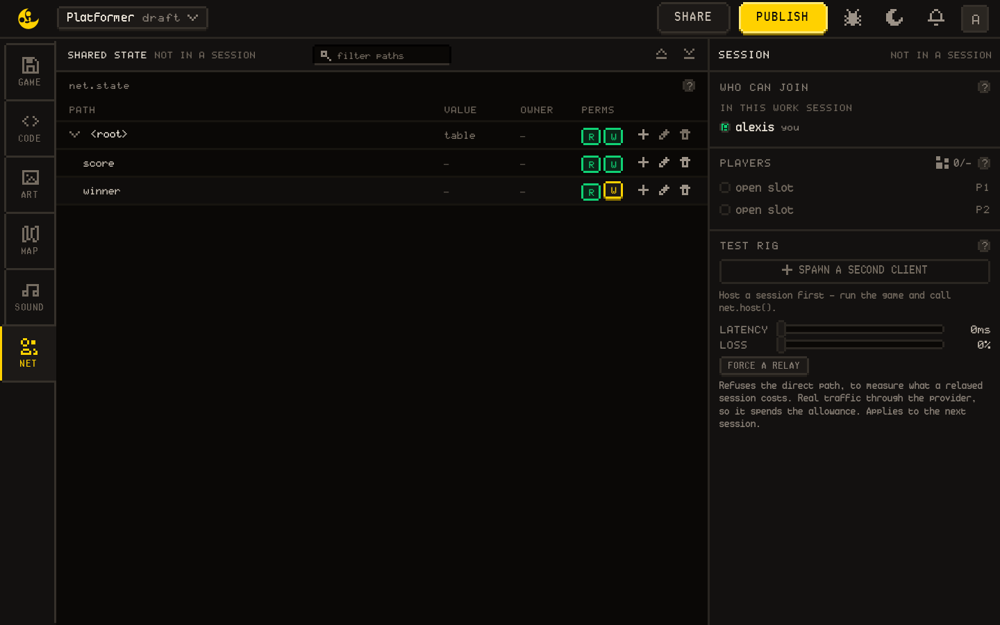
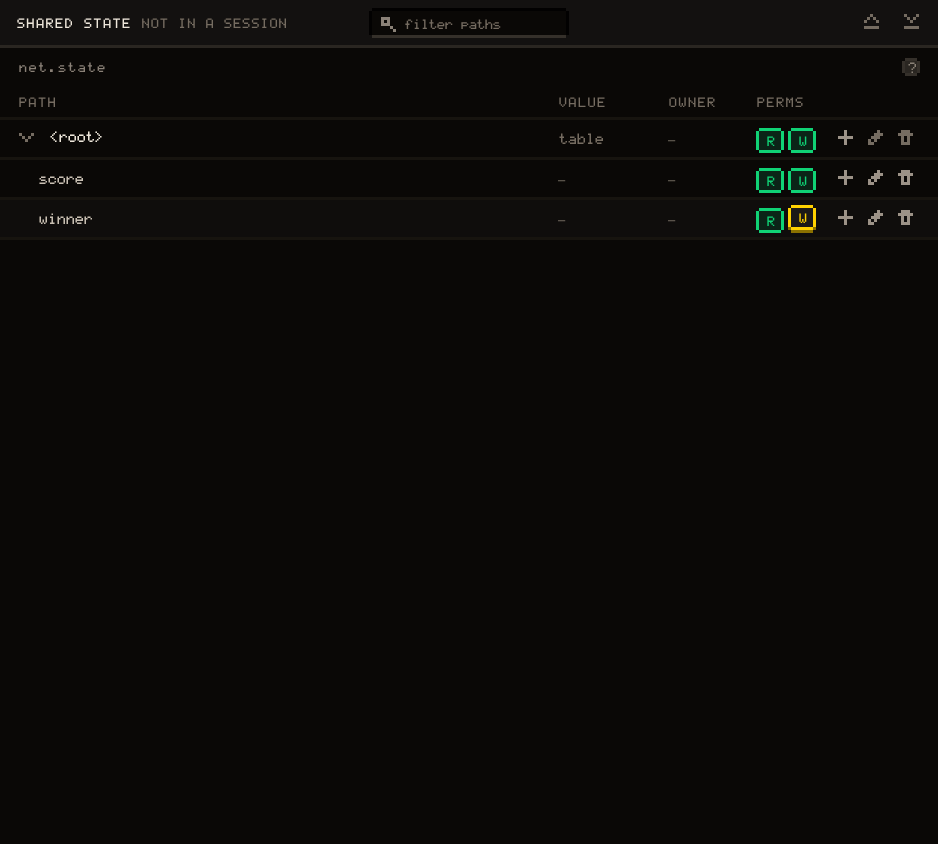
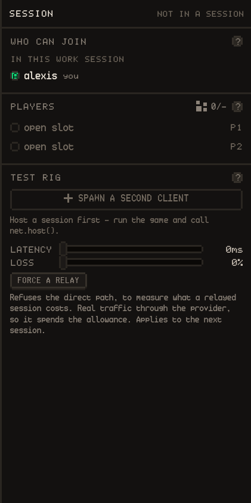
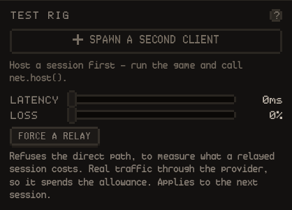

# NET

The NET tab is where a multiplayer game's **rules** live: which paths of its shared state joined clients may read and write. You declare them before anything runs, and once the game is in a session the same table shows what each path holds. The panel beside it is the session itself: who can join, who is playing, and a debug drawer with a second client to play against yourself. The model behind it is on [Multiplayer](/learn/concepts/multiplayer); what the permissions are for is the [Permissions & authority](/learn/tutorials/permissions) tutorial.

## The layout

The workspace is the RULES table, and its head says `live` while the game is in a session. The panel on the right is the SESSION column, in three parts: WHO CAN JOIN, PLAYERS and DEBUG.

### RULES

The table is every path the game declares under [[net.state]], and, while a session runs, every path it holds.

- **Path** is the tree, from `<root>` down, with a chevron to fold a branch. Filter paths in the head narrows it.
- **Rule** says where a path's flags come from. `OWN` is a rule set on the path itself. **from** a path is a rule taken from the nearest ancestor that has one, so a branch you lock is locked all the way down. **open by default** is a path no rule reaches: joined clients may read and write it.
- **Read** and **Write** are whether joined clients may read and write the path. The host is never restricted.

The rules live in the game, so they travel with it, and nothing has to run to set them. **+ Path** in the head declares a path under the root, and `+` on a row, Add child node, declares one under that row; a dotted name such as `players.score` declares the whole branch at once. A path you declare has **no rule of its own**: it takes its parent's, and says so. Ticking Read or Write on it gives it one, and the arrow that then appears, Inherit again, drops that rule so the path follows its parent once more. The pencil renames the last segment, and the trash deletes the path with everything under it.

While the game is in a session, two columns join the table on the right: **Value**, a Lua literal, so a string keeps its quotes and an empty one is visible, and **Owner**, who holds the path, `host` in gold or a peer's name. A branch says how many entries it has, and a declared path the session has not reached reads `nil`. Paths the session holds that you never declared are listed too, greyed: tick Read or Write on one to give it a rule. On a narrow editor the Rule column folds into an `OWN` mark beside the name, and Owner is left out so the paths stay readable.

### SESSION

The column's head says `hosting`, `joined` or `not in a session`.

WHO CAN JOIN lists the people of this work session who are not playing. Everyone here can take a player slot, and while you host, **Invite** beside a name sends them a notification that opens the session. Anyone else needs the **code**, shown under the list with a copy button while a session runs. The button under it is End session for the host and Leave session for a client; either way the game restarts.

PLAYERS lists who is in the game, each once, with `n/max` in its head, where the maximum is what the game asked for in [[net.host]] with `max_players`, the host included. A row has the player's name, `HOST` on the host's, their ping and their seat, `P1`, `P2`; under the rows, how many slots are still open.

### DEBUG

DEBUG is folded until you open it. **Spawn a second client** opens a second copy of the game as a small screen inside the drawer, on this machine, so you can test netplay alone. It needs a session first: run the game and call `net.host()`. The second copy is opened on your session, as an invited player's is, and starts at `_init` like any run. A game that joins from `_init` when [[net.invite]] answers is in at once; any other joins the way a player would, through its own menu: click its screen to give it the keyboard, then press the key your menu uses to join. The drawer says `Waiting for this client to call net.join()` until then, and `Joined as a second player` after. Close the second client takes it away.

Since the rig is on NET and the console column is on CODE, **pop the viewer out** before you come here, or your own game pauses while you are on this tab and the host with it; and turn Auto off, since an edit reruns the game and a rerun ends the session.

Latency, 0 to 400 ms, and Loss, 0 to 30 %, are applied to that client's outgoing traffic, not to yours. They are live while the rig is open.

> [!NOTE]
> The second client runs on your account but plays under an id of its own, so [[net.id]] answers a different number in each client. PLAYERS lists it as **you (test client)**, and a game that keys its players by id treats it as a second player.

**Force a relay** refuses the direct path, to measure what a relayed session costs. It sends real traffic through the platform's relay, which is metered, so turn it off once you have your measure; it applies to the next session, not the one running. The **Route** line under it says, once anything has been sent, whether the connection is `direct` or `relayed`, with the traffic so far and its rate per hour.
