# SOUND

The SOUND tab is where you build instruments, write patterns on a piano roll, lay those patterns out on the timeline of a music, and write the sound effects your game plays. Everything here goes through the console's own synthesizer: **five voices**, a handful of waves, and samples of about a second.

A **voice** is one sound playing at a time; five voices means five notes can sound at once, and a sixth has to wait or take one over.

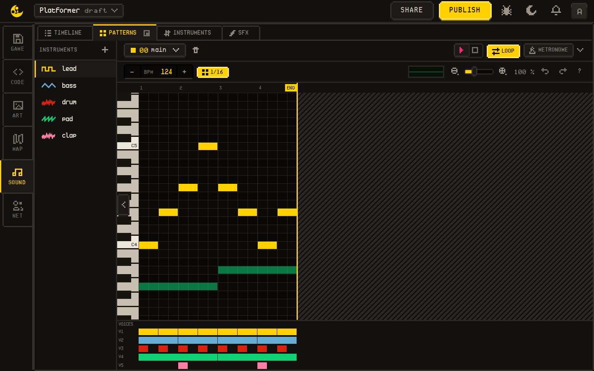

## The four windows

SOUND has four editors, each in a tab of its own:

- **Timeline** lays patterns out, bar after bar, to make a music.
- **Patterns** writes the notes of a pattern on a piano roll.
- **Instruments** sets how an instrument sounds.
- **SFX** writes the sound effects the game plays by number.

The four tabs are the base view, and you can stay in it. Each tab can also be **popped out** into a window of its own, to see two editors side by side:

- The small square on a tab pops it out. Dragging a tab away from its bar does the same.
- A window that is out moves by its title bar and resizes from its bottom-right corner. The arrow in its title bar puts it back where it came from.
- While a window is dragged, squares show where it can go: the cross in the middle of a zone docks it on that side of the zone, or as a tab in the middle; the four squares on the edges of the workspace dock it along a whole side. Over a tab bar, a gold line shows where the tab will be inserted.
- The `+` at the end of a tab bar brings any other window here.
- The line between two zones resizes them. A zone never gets smaller than 360 × 280 pixels.

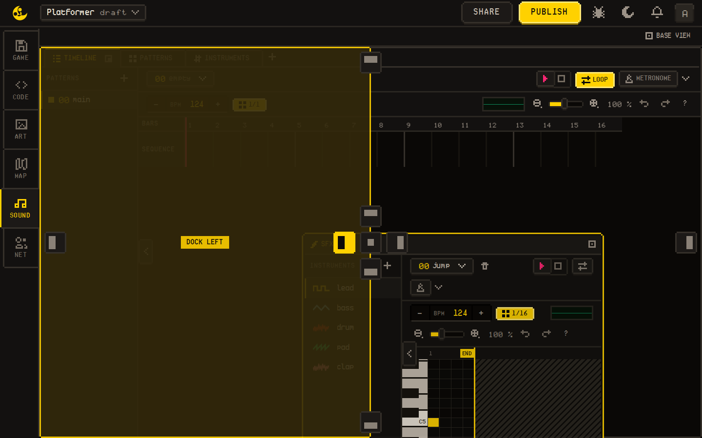

**Base view**, above the workspace, puts every window back in one bar of tabs. If the browser gets too small for your layout, SOUND shows the base view for the time being and says so; your layout comes back when the window grows, or Base view in the notice drops it. The layout is yours alone: nobody else in the session sees it, and it is not kept when the page reloads.

The window you last clicked has a gold frame and gets the keyboard, so <kbd>Space</kbd> plays whatever is in it. Only one thing plays at a time: starting the timeline stops a pattern, and the tab or the window that is playing carries a pink dot.

A new game has no sound at all. Instruments says **No sound yet** and offers Add instrument; a note is placed with an instrument, so it is the first thing to make.

## Instruments

The instrument list sits on the left of Patterns, Instruments and SFX; the grip on its edge folds it away. The `+` at its head opens the **New instrument** dialog. It offers two starts: From a preset, or Custom, a plain square wave with a short envelope you set up yourself.

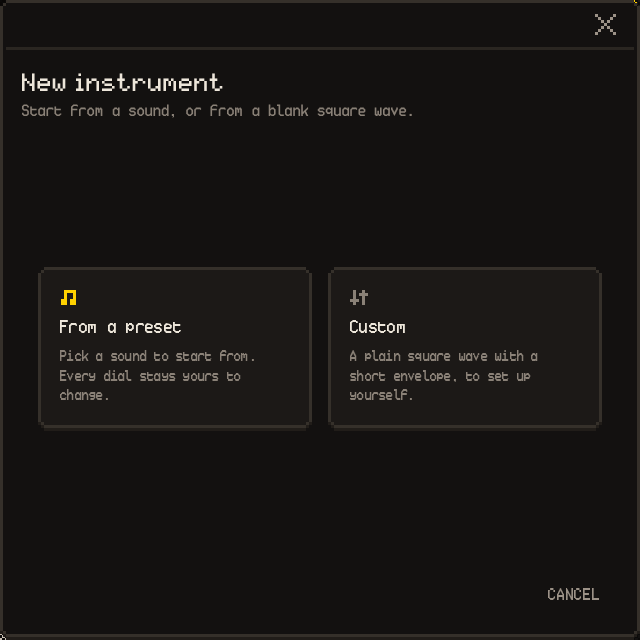

From a preset shows 23 sounds on shelves: All, Lead, Bass, Keys, Pad, Drums and Effects. A card **plays when it is clicked**, at the note the preset is written for, so a kick is heard as a kick. Create makes the instrument under the preset's name, and every dial of it stays yours to change.

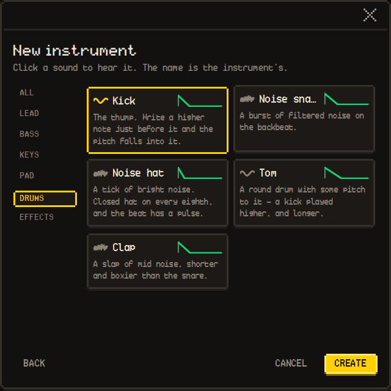

The selected instrument, with the gold edge, is the one new notes are written with, and its colour paints its notes on the roll. Hover a row for three actions: Duplicate, the pencil, which opens **Rename instrument** (a name of up to 16 characters and one of the accent colours), and the trash.

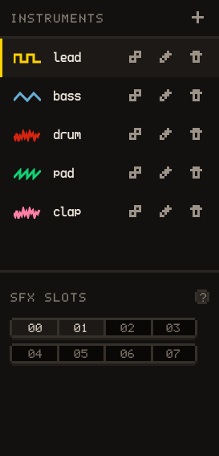

> [!NOTE]
> The trash asks first when the instrument is in use, and the dialog counts the patterns and SFX that lose its notes; an unused one goes at once. Either way a message offers **Undo** for a few seconds, and <kbd>Ctrl/⌘</kbd>+<kbd>Z</kbd> brings it back too.

### The Instruments window

The Instruments window is the selected instrument itself, in four cards, with a keyboard along the bottom to try it.

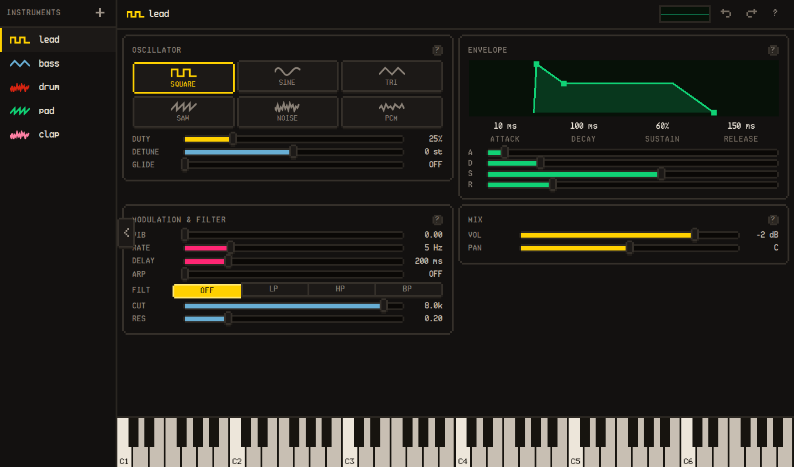

**OSCILLATOR** picks the raw wave: Square, Sine, Tri, Saw, Noise or PCM. Square adds a DUTY slider (5 % to 95 %): the duty is the share of each cycle the wave spends high, and it changes the tone, hollow at 50 %, thinner towards the ends. Noise ignores pitch. Under the wave, DETUNE shifts every note by up to 12 semitones either way, a semitone being the distance between two neighbouring keys of the keyboard, and GLIDE (0 to 500 ms) is the time the pitch takes to slide from one note to the next.

**ENVELOPE** is how loud the note is over its life, in four stages: attack, the time it takes to reach full volume; decay, the time it takes to fall from there to the sustain level; sustain, the level it holds while the note lasts; release, the time it takes to fade once the note ends. The graph has draggable handles: the peak moves attack, the next one decay and sustain at once, the last one release. The A, D, S and R sliders under it are the precise control: A, D and R are times, up to 3 s each, and S is a level, from 0 to 100 %.

**MODULATION & FILTER** starts with VIB, the depth of the vibrato, a small wobble of the pitch; RATE is its speed (1 to 20 Hz) and DELAY how long the note waits before it starts wobbling.

ARP is the **arpeggio**: it walks a chord with a single voice, at 0 to 30 Hz; write several notes on the same step and the instrument plays them in turn. OFF holds them all at once.

FILT is a **filter**, which takes part of the sound away: LP (low-pass) keeps the low frequencies, HP (high-pass) keeps the high ones, BP (band-pass) keeps a band in the middle. CUT is the cutoff, the frequency where the filter starts to cut, and RES the resonance, how much it boosts the sound right at that frequency.

**MIX** is the instrument's own VOL and PAN. Every note it plays goes through them.

The keyboard at the bottom goes from C1 to B6, and plays the instrument for as long as a key is held; a drag across the keys plays them one after another.

### PCM samples

With PCM as the wave, the OSCILLATOR card gains **Import a sample**. Any audio file will do: it is mixed to mono and resampled to 8-bit at 8 kHz, and cut to the budget of 8 KB, which is about one second. The readout beside the button says what the sample costs, for instance `0.6 s · 4.8 KB`; Replace swaps it and the cross removes it.

ROOT is the note at which the sample plays at its recorded pitch, C4 by default. Every other note on the roll speeds it up or slows it down from there.

> [!IMPORTANT]
> A sample is bytes the game carries. Longer than the budget, the tail is cut, not compressed.

## Patterns

A **pattern** is a short phrase of notes, the brick a music is built from. The menu at the head of the Patterns window says which pattern is in front of you: its colour, its number, counted from `00`, and its name.

- Open the menu to pick another pattern. The `+` at its head makes a new one, one bar long.
- Hover a row for Duplicate and the trash.
- Click the row of the pattern already chosen to rename it in place; <kbd>Enter</kbd> keeps the name, <kbd>Esc</kbd> leaves it.

A pattern's colour is the colour of the instrument it uses most, and that is the colour of its blocks on the timeline.

The trash beside the menu clears the notes of the pattern; the pattern itself stays, and so do its blocks. The trash of a row in the menu removes the pattern: it asks first, says in which musics it is used, and its blocks go, leaving silences.

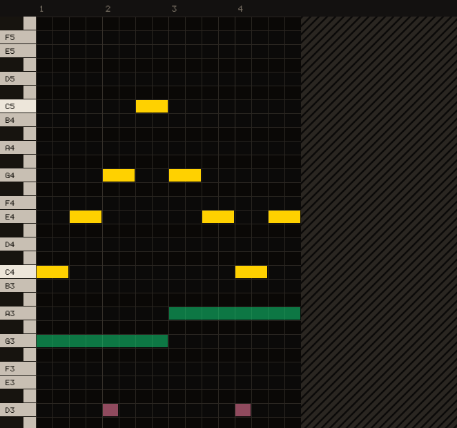

### Writing notes

The roll holds 72 pitches, **C1 to B6**, the highest at the top, with a keyboard at the left; steps run across, four to a beat.

- Left click on an empty cell places a note of one snap unit with the selected instrument. Keep the button down and drag to the right, or to the left, and the note stretches from the cell it was put in.
- Left click on a note and drag to move it, in pitch and in time. Within a few pixels of either edge, the drag takes that edge instead, so a note stretches or shrinks from its start or its end.
- Right click deletes a note.
- A note placed, moved or grabbed sounds once, so you hear what you wrote.

**Snap** is the grid a note lands on, so that a click a little off still puts the note on a step: one press cycles Off, 1/4, 1/8, 1/16, 1/32 and back. The default is 1/16, one step. Off places freely, down to an eighth of a step.

The zoom goes from 50 % to 400 %: the two magnifiers double or halve it, the slider sets it, and the percentage sets it back to 100 %. Patterns and SFX each keep their own.

The keyboard at the left of the roll plays the selected instrument for as long as a key is held, and a drag across the keys is a **glissando**, a slide through every note on the way. It sounds on the fifth voice, so a pattern playing underneath keeps the others.

The **VOICES** lane under the roll shows the five voices, each lit while it sounds, and the oscilloscope in the bar draws the output.

### How long a pattern is

A pattern has no length to type in. As in FL Studio, it follows its notes:

- Click past **END**, the gold line, and the note goes there and the pattern grows to the end of that bar. Past END, the roll always shows a bar more to write in.
- Take that note out again and the pattern shrinks back to the last bar that still has a note. An empty pattern is one bar.
- Drag **END** along the ruler to set the length by hand, a beat at a time, up to 128 steps. A length set by hand stays, and only grows when a note goes past it. Shortening it asks first, **Shorten this pattern?**, if notes would go.

Lengthening a pattern with END pushes the blocks that follow it on every timeline, so nothing overlaps; a length that only follows the notes never moves a block. A shorter pattern leaves a silence where it used to end.

### Tempo, transport and metronome

BPM, beats per minute, is the pattern's tempo when it plays on its own, from 40 to 240. In a music, the music's tempo is the one that counts.

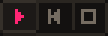

Play starts the pattern from wherever the head stands, and becomes Pause while it runs; Pause keeps the head where it was. Stop ends the take and the head goes out. The ruler at the top of the roll places the head: click it, or drag along it, during playback too.

Loop repeats the pattern. **Metronome** ticks on every beat and never writes into the pattern; the arrow beside it opens its settings:

- **Beat**: a click every 1/4, 1/8 or 1/16 of a bar.
- **Volume** of the clicks.
- **Accent on the first beat**: the first beat of each bar is louder, to keep your place.
- **One bar count-in**: a bar of clicks before playback starts, to get ready.

Loop and Metronome keep their icons and lose their words when the window is narrower than 900 px.

## Timeline

A **music** is a row of patterns laid out on a timeline, bar after bar, that the game starts with [[sound.play_music]]. The menu at the head of the Timeline window picks the music, numbered from `00`, and works like the pattern menu: `+` makes one, a row's actions duplicate or remove it, and a click on the chosen one renames it. Removing a music leaves its number empty, and the others keep theirs, so the game's calls still reach them.

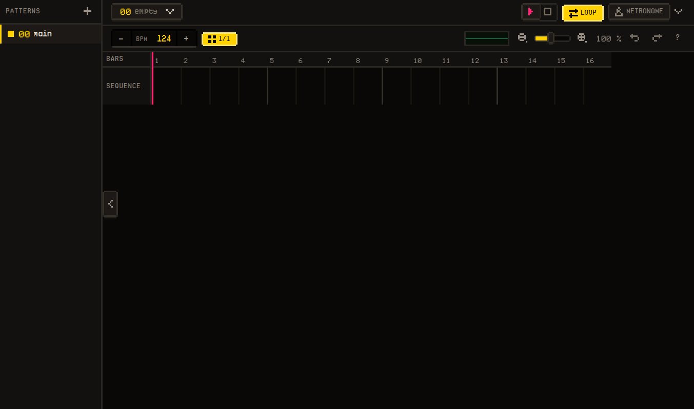

The list on the left holds every pattern. Drag one onto the track and it becomes a **block** where you drop it. A block shows its pattern's number and a small picture of its notes, and lasts as long as the pattern does.

- Drag a block to move it; drag it off the track to remove it. A block placed over others replaces them.
- Drag the right edge of a block to repeat its pattern.
- Click a block to choose it, <kbd>Shift</kbd> + click to choose several. Choosing a block also shows its pattern in Patterns, and a double-click brings Patterns to the front.
- <kbd>Enter</kbd> puts the pattern chosen in the list at the playhead.
- <kbd>Ctrl/⌘</kbd>+<kbd>D</kbd> duplicates the chosen blocks right after them; <kbd>Ctrl/⌘</kbd>+<kbd>C</kbd> and <kbd>Ctrl/⌘</kbd>+<kbd>V</kbd> copy them and paste them at the playhead; <kbd>Delete</kbd> removes them; <kbd>Esc</kbd> chooses none.

The ruler counts bars from `1`. Clicking it moves the playhead; the grey line is the end of the music. The grid snaps blocks to a whole bar, or to 1/2, 1/4 or 1/8 of one; one press cycles. The zoom goes from 50 % to 225 %.

**BPM** in the Timeline window is the music's own tempo. It holds for the whole music, whatever tempo its patterns have when they play alone.

**Loop** makes the music start over when it reaches the loop's end. The two marks on the ruler say where: the gold one is where the loop starts again, the orange one where it ends. Leave the orange one at the end of the music and it follows the music as it grows.

## SFX

A **sound effect** is a short phrase of its own, with its own name, tempo, length and notes, kept at a number the game plays with [[sound.play_sfx]]. It does not depend on any pattern.

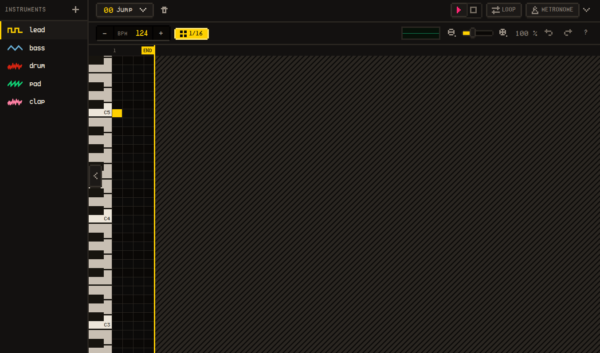

The menu at the head of the SFX window lists every number up to the last one used; a number with nothing in it says empty. The `+` adds a sound effect at the end, a row's actions duplicate it or remove it, and a click on the chosen one renames it, in up to 16 characters. **Removing a sound effect empties its number and moves no other**, so the game's calls still reach the ones that are left. The roll, the length, the tempo, the transport and the metronome work as in Patterns.

``` lua
function _update()
  if input.pressed("a") then
    sound.play_sfx(1) -- the sound effect at number 01
  end
end
```

`"a"` there is the **action**, not the key A: in a new game it is <kbd>X</kbd> or <kbd>Space</kbd> on the keyboard, and the A button of a gamepad (see [input](/learn/api/input#actions)).

A sound effect takes the first free voice of the five. When none is free it takes one from the music, oldest first, so the music keeps playing on the others.

## Working together

Everyone in the session edits the same sounds, and sees the others at work:

- A coloured dot on a tab says who is in that window; the same dots on the left rail say who is in which editor.
- While their pointer is in a window, it gets a frame of their colour, with their name.
- On the timeline and on the rolls, their pointer moves with their name on it, and the blocks they have chosen carry their colour.

## Undo and redo

The two arrows in each bar, and <kbd>Ctrl/⌘</kbd>+<kbd>Z</kbd> / <kbd>Ctrl/⌘</kbd>+<kbd>Shift</kbd>+<kbd>Z</kbd>, undo and redo **your own** changes, the latest first, whichever window they were made in: instruments, patterns, musics, sound effects and samples, a deleted one included. SOUND keeps your last 200 steps; older ones can no longer be undone, so a long session does not weigh on the saved game. What someone else did stays.

When something is removed, a message says what went and offers **Undo** for a few seconds; it goes away as soon as you change anything else.

## Shortcuts

The `?` at the end of each bar lists the shortcuts of that window.

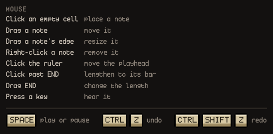

| Key | Does |
| --- | --- |
| <kbd>Space</kbd> | Play what is in the active window, or pause it |
| <kbd>Ctrl/⌘</kbd>+<kbd>Z</kbd> | Undo |
| <kbd>Ctrl/⌘</kbd>+<kbd>Shift</kbd>+<kbd>Z</kbd> or <kbd>Ctrl/⌘</kbd>+<kbd>Y</kbd> | Redo |
| Right click on a note | Delete it |
| Drag on a ruler | Move the head, during playback too |
| <kbd>Enter</kbd> on the timeline | Put the chosen pattern at the playhead |
| <kbd>Ctrl/⌘</kbd>+<kbd>D</kbd> on the timeline | Duplicate the chosen blocks |
| <kbd>Ctrl/⌘</kbd>+<kbd>C</kbd> / <kbd>Ctrl/⌘</kbd>+<kbd>V</kbd> on the timeline | Copy the chosen blocks, paste them at the playhead |
| <kbd>Delete</kbd> on the timeline | Remove the chosen blocks |
| <kbd>Esc</kbd> on the timeline | Choose no block |

See [sound](/learn/api/sound) for the whole audio API, [[sound.play_note]] included, which plays an instrument from code without a pattern.
