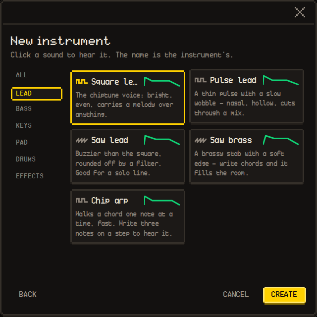
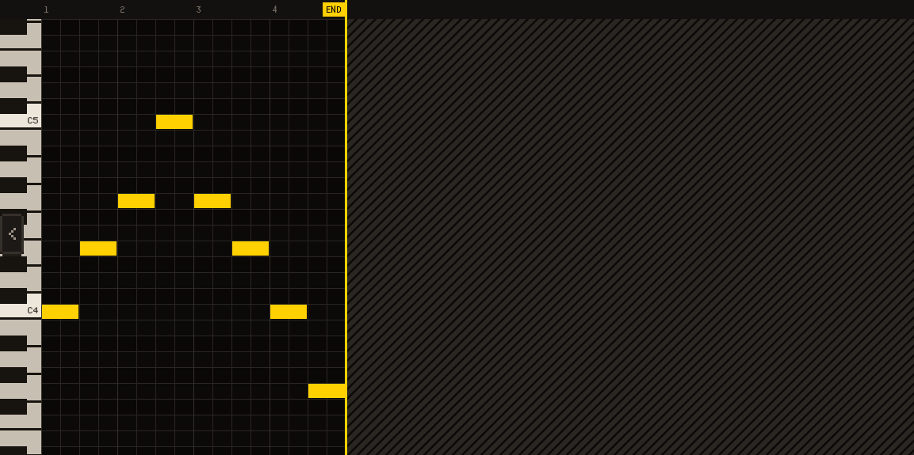
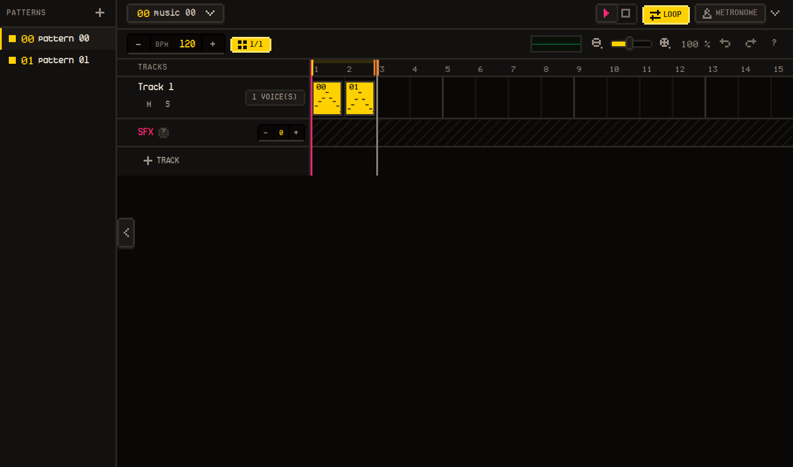
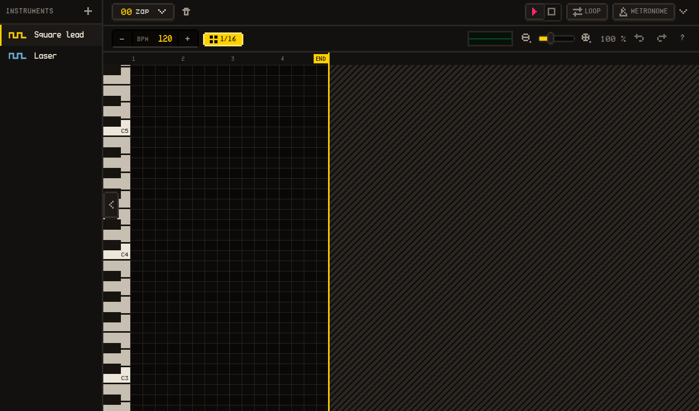
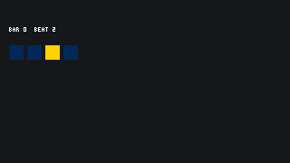

# Make it sound

This tutorial gives a game its first sounds: a short loop that starts with the game, a zap on a key press, and a beat indicator drawn from where the music stands. It takes about ten minutes, visits SOUND for three steps and CODE for two, and needs no sprites and no map.

Each step explains one idea and gives the code it adds, whole: a function is always shown from `function` to `end`, so it can be typed or pasted as it stands, and a function shown again replaces the one you had.

## What you will build

A black screen with four boxes. While the music plays, the box of the current beat lights up and a line says which bar is going by. The `a` action (<kbd>X</kbd>) zaps; `pause` (<kbd>Enter</kbd>) fades the music out, and again brings it back.

**Copy to new game** at the head of the page installs the code alone: instruments, patterns, the music and the sound effect are not carried over, so the copy runs silent until Steps 1 to 4 are done. A game that asks for a sound it does not have raises no error; it plays nothing.

## Step 1: An instrument from a preset

Open **SOUND**. It has four tabs, Timeline, Patterns, Instruments and SFX, and opens on **Patterns**: a piano roll with an empty list of instruments beside it. A note is written with an instrument, and a new game has none yet.

### The New instrument dialog

Click the `+` at the head of INSTRUMENTS. The **New instrument** dialog offers two starts: From a preset, or Custom, a plain square wave with a short envelope you set up yourself. Take From a preset.

### A family, then a card

The presets sit on shelves by family: All, Lead, Bass, Keys, Pad, Drums and Effects. A lead carries a melody, a bass sits under it, drums keep time, effects are for the game rather than the music. Open the **LEAD** shelf and click Square lead: a card plays when it is clicked, at the note it is written for, so you hear what you are about to get. Create makes the instrument under the preset's name.



Square lead appears in INSTRUMENTS with a gold edge: it is the **selected** instrument, the one new notes are written with, and its colour is the colour its notes will have on the roll. The **Instruments** tab shows its dials. Leave them; every one of them stays yours to change later.

> [!TIP]
> The keyboard at the left of the roll plays the selected instrument for as long as a key is held. Try a few before writing anything.

## Step 2: A pattern on the piano roll

The roll shows pitches down the side, from C1 to B6, and steps across, four to a beat. The menu at the head of the window reads `00`: you are on pattern `00`, and it is one bar long, which is what the ruler over the roll numbers `1` to `4`.

### Tempo

Set **BPM** to `120`. That is the tempo the pattern plays at on its own; in a music, the music's tempo counts, and Step 3 sets it to the same.

### Notes

Snap, in the second row of the bar, is the grid a note lands on. The default, 1/16, is one step, and it is the one you want. Left click on an empty cell places a note one step long with the selected instrument; keep the button down and drag to the right to stretch it, **to the last cell the note should cover**: a two-step note is dragged from its own cell to the next one. Right click deletes one. A note that is placed or moved sounds once, so you hear what you wrote.

Write eight notes, each two steps long, one after the other, so the bar is full:

| Beat | 1 | 2 | 3 | 4 |
| --- | --- | --- | --- | --- |
| Pattern 00 | C4 E4 | G4 C5 | G4 E4 | C4 G3 |



A pattern is as long as its notes, a bar at a time: a note written past **END**, the gold line, makes it a bar longer, and taking that note out makes it a bar shorter again. Keep this one to a bar; Step 5 counts on it.

### Hear it

Play in the bar, or <kbd>Space</kbd>, plays the pattern from where the head stands, and **Loop**, on by default, repeats it, so the bar goes round while you fix a note. Stop ends the take and the head goes out. Metronome ticks on every beat and never writes into the pattern.

> [!TRY]
> Press <kbd>Space</kbd>. The bar plays round, the head sweeps the roll and the VOICES lane under it lights one voice per note. A note that sounds wrong can be dragged to another row while it plays.

## Step 3: A second pattern, and a music

A music lays patterns out on a timeline, bar after bar. One pattern is a bar; two make something that goes somewhere.

### Pattern 01

Open the pattern menu, the one that reads `00`, and click its `+`: pattern `01` is made, one bar long, and it is now in front of you. Set its BPM to `120` too, and write an answer to the first bar, two steps a note as before:

| Beat | 1 | 2 | 3 | 4 |
| --- | --- | --- | --- | --- |
| Pattern 01 | A3 C4 | E4 A4 | E4 C4 | A3 G3 |

### The timeline

Open the **Timeline** tab. Its menu reads `00`: that is music `00`, the one the game will ask for, and it is empty. Set its **BPM** to `120`: a music has one tempo, which holds for every pattern in it.

The list on the left holds the patterns. Drag `00` onto the track and drop it on the first bar; drag `01` and drop it on the second. Each becomes a **block**, a bar wide, with a small picture of its notes.



**Loop** is on, and the two marks on the ruler say where the loop starts again and where it ends: the start of the music and its end, for now.

> [!TRY]
> Press Play in the Timeline. The first bar, the second, and round again; the head runs along the track. Click the first block: Patterns now shows pattern `00`, and a double-click brings Patterns to the front.

## Step 4: A sound effect

A sound effect is a short phrase of its own, at a number the game plays by.

### The Laser

Add a second instrument: `+`, From a preset, the **EFFECTS** shelf, Laser, Create. It is now the selected instrument.

### SFX 00

Open the **SFX** tab. Its menu reads `00`, empty for now. Put a single note on the first step, `G6`, near the top of the roll: the sound effect at number `00` is made with it. Play it with Loop off: a zap. Each instrument has its own colour, so the note is not the colour of Step 2.



### Play it from code

Switch to **CODE**, delete the starter script, and start with the numbers SOUND decided:

``` lua
SFX_ZAP    = 0   -- the sound effect, as the SFX menu shows it
MUSIC_MAIN = 0   -- the music, as the Timeline menu shows it
```

[[sound.play_sfx]] plays a sound effect by number, once, on the first free voice. Ask for it on the frame the button goes down with [[input.pressed]], which is true once per press. [[input.held]] would be true on every frame the key is held and start the zap sixty times a second.

``` lua
function _update()
  if input.pressed("a") then
    sound.play_sfx(SFX_ZAP)
  end
end
```

For now `_draw` only clears the screen:

``` lua
function _draw()
  gfx.clear(0)
end
```

> [!TIP]
> The third argument of [[sound.play_sfx]] transposes: `sound.play_sfx(SFX_ZAP, nil, 7)` is the same zap a fifth higher, so one sound effect gives several sounds.

> [!TRY]
> Press Play, then <kbd>X</kbd>. One zap per press, however long the key is held. An empty number plays nothing and raises no error, so a silent press means the number in the code and the one in SOUND do not match.

## Step 5: Music from the first frame

### Start it in `_init`

[[sound.play_music]] starts a music by its number and **loops it by default**; a second argument of `false` plays it once, and a third fades it in over that many seconds. A game plays one music at a time: starting another replaces it.

``` lua
function _init()
  music_on = true
  sound.play_music(MUSIC_MAIN)
end
```

> [!NOTE]
> A browser lets a page make sound only after you have clicked or pressed a key on it. Pressing Play counts, and the music asked for in `_init` waits for the audio to come up, so the first bar can arrive a moment after the first frame.

### Stop it on pause, and bring it back

[[sound.stop_music]] stops the music at once, or over a fade when given seconds. On the `pause` action (<kbd>Enter</kbd> on the keyboard, Start on a gamepad) fade it out over half a second; on the next press start it again from its first bar. `_update` keeps the zap from Step 4 and grows the second test:

``` lua
function _update()
  if input.pressed("a") then
    sound.play_sfx(SFX_ZAP)
  end

  if input.pressed("pause") then
    if music_on then
      sound.stop_music(0.5)
    else
      sound.play_music(MUSIC_MAIN)
    end
    music_on = not music_on
  end
end
```

What SOUND decided is not final: [[sound.set_music]] can raise the tempo of a music from code, and [[sound.set_instrument]] change how an instrument sounds, **for this run only**; the game keeps what you wrote in SOUND.

### A beat indicator

[[sound.music_pos]] answers two numbers while a music plays: the **bar** that is sounding, counted from `0`, and the **beat** inside that bar, `0` to `3`. When nothing plays it answers `nil`.

The text goes at `y = 30` and the boxes under it rather than at the top: the game screen in CODE wears an FPS badge in its top-left corner, and a line printed at `10, 10` would sit under it. The badge is the editor's, not the game's; Settings, on the Account tab, has it under Show FPS counter.

``` lua
function _draw()
  gfx.clear(0)

  local bar, beat = sound.music_pos()
  if bar == nil then
    gfx.print("NO MUSIC", 10, 30, 3)
    return
  end

  for i = 0, 3 do
    local colour = 15                    -- dark blue
    if i == beat then colour = 4 end     -- yellow on the beat
    gfx.fill_rect(10 + i * 20, 50, 16, 16, colour)
  end

  gfx.print("BAR " .. bar .. "  BEAT " .. beat, 10, 30, 5)
end
```

> [!IMPORTANT]
> The position comes back from the audio thread a frame or two late, and a beat lasts many frames, so a test like `beat == 0` stays true for a few frames in a row. Fine for a light; for something that must happen once per beat, compare against the beat you saw last frame.

> [!TRY]
> Press Play. The four boxes light in turn, one per beat, and `BAR` reads `0` for the first bar, `1` for the second, then `0` again: the music loops. <kbd>Enter</kbd>: the music fades over half a second, and `NO MUSIC` appears once the fade is over, not before. <kbd>Enter</kbd> again brings it back from the top.



## Extending the example

- A kick under the melody: a third instrument from the DRUMS shelf, and a note of it on every beat of both patterns.
- A rest: leave the third bar of the timeline empty and drag the orange loop mark one bar further, so the music waits a bar before it loops.
- A zap on the beat: only play it when the beat has just changed, and see how the fade in [[sound.play_music]] sounds under it.
- A pause screen: [[sound.set_volume]] halves everything while it is up, without stopping the music.
- A note without a pattern: [[sound.play_note]] plays an instrument by name, from code, for a pickup jingle.
- A faster last lap: `sound.set_music(MUSIC_MAIN, { bpm = 160 })` when the timer runs low. The music picks up the tempo at once, and the Timeline in SOUND still says 120.
